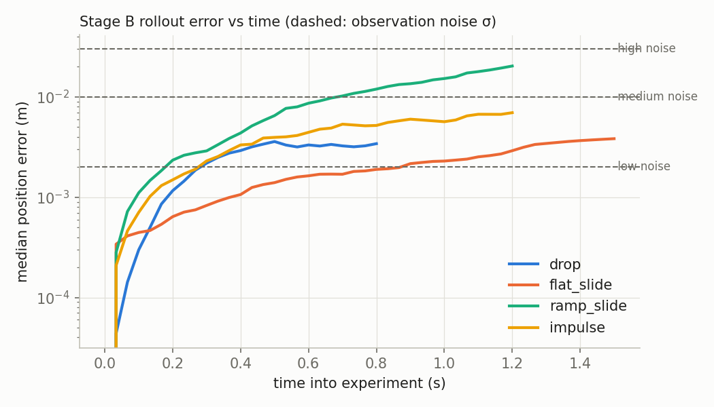
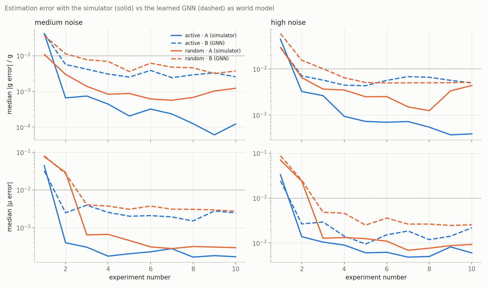

# Stage B: GNN world model vs Stage A simulator

Model: stageB-gnn-gscaled-ensemble5, trained on 4000 trajectories (80/10/10 split by scene and parameter draw).

## 1. Rollout accuracy on held-out trajectories

400 test trajectories, each an unseen (scene, g, μ) draw. Open-loop rollout of the ensemble mean from the known setup, compared with the noiseless simulator.

| experiment | n | position RMSE (m) | median final position error (m) |
|---|---|---|---|
| drop | 110 | 0.0039 | 0.0034 |
| flat_slide | 90 | 0.0076 | 0.0038 |
| ramp_slide | 91 | 0.0207 | 0.0204 |
| impulse | 109 | 0.0122 | 0.0070 |
| all | 400 | 0.0127 | |

One-step velocity error (ensemble mean), by transition type:

| transition | count | median |Δv error| (m/s) | 95th percentile |
|---|---|---|---|
| free flight | 2120 | 0.0017 | 0.0113 |
| contact (sliding/resting) | 11608 | 0.0043 | 0.0251 |
| impact (lands this step) | 162 | 0.0761 | 0.7650 |

Calibration: fraction of test predictions (after the first frame) inside the model's own 90 % band (ensemble spread + calibrated floor; ideal 0.90):

| x | y | vx | vy |
|---|---|---|---|
| 0.91 | 0.94 | 0.97 | 0.99 |

## 1b. Can g be recovered through the model?

Best-fit g (grid step 0.025) when noise-free simulator trajectories are fitted through the learned model with μ = 0.3 known. Stage A recovers g exactly.

| experiment | g* = 4 | g* = 8 | g* = 12 | g* = 16 |
|---|---|---|---|---|
| drop(ball, height=1.50) | 4.03 | 8.07 | 12.00 | 15.88 |
| drop(block, height=1.00) | 4.00 | 8.00 | 12.00 | 15.90 |
| flat_slide(block, v0=2.50) | 4.03 | 7.98 | 11.95 | 15.93 |
| ramp_slide(block, angle_deg=30.00, start=2.00) | 4.05 | 7.88 | 11.70 | 15.62 |
| impulse(heavy_block, direction_deg=20.00, impulse=4.00) | 4.03 | 8.15 | 12.08 | 15.85 |

Median |bias| 0.6%, worst 2.5%.

## 2. Speed

Predicting one ramp-slide experiment for 400 hypotheses:

| predictor | seconds |
|---|---|
| Stage A (Pymunk) | 0.556 |
| Stage B (GNN ensemble of 5) | 0.840 |

## 3. Inference with Stage B as the world model

Same seeds (0–9), hidden physics and observation noise as the Stage A sweep; the world is still Pymunk. Budget 10; threshold |g error| ≤ 1 %, |μ error| ≤ 0.01, held to the end (never reached counts as 11).

| noise | strategy | predictor | mean exps (never = 11) | reached | final g rel err (median) | final μ err (median) | 90% CI coverage g / μ | traj RMSE m (median) | s / run |
|---|---|---|---|---|---|---|---|---|---|
| medium | active | A (simulator) | 1.70 | 10/10 | 0.0001 | 0.0002 | 0.88 / 0.97 | 0.0002 | 36 |
| medium | active | B (GNN) | 2.30 | 10/10 | 0.0026 | 0.0025 | 0.39 / 0.62 | 0.0036 | 77 |
| medium | random | A (simulator) | 2.50 | 10/10 | 0.0012 | 0.0003 | 0.94 / 0.97 | 0.0008 | 15 |
| medium | random | B (GNN) | 5.10 | 9/10 | 0.0037 | 0.0027 | 0.62 / 0.58 | 0.0033 | 34 |
| high | active | A (simulator) | 1.80 | 10/10 | 0.0004 | 0.0006 | 0.91 / 0.95 | 0.0007 | 30 |
| high | active | B (GNN) | 4.50 | 9/10 | 0.0049 | 0.0022 | 0.49 / 0.77 | 0.0032 | 96 |
| high | random | A (simulator) | 3.40 | 10/10 | 0.0044 | 0.0009 | 0.97 / 0.97 | 0.0022 | 59 |
| high | random | B (GNN) | 6.00 | 9/10 | 0.0051 | 0.0025 | 0.89 / 0.84 | 0.0042 | 51 |
