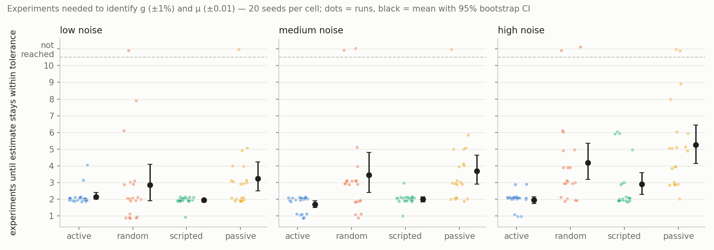
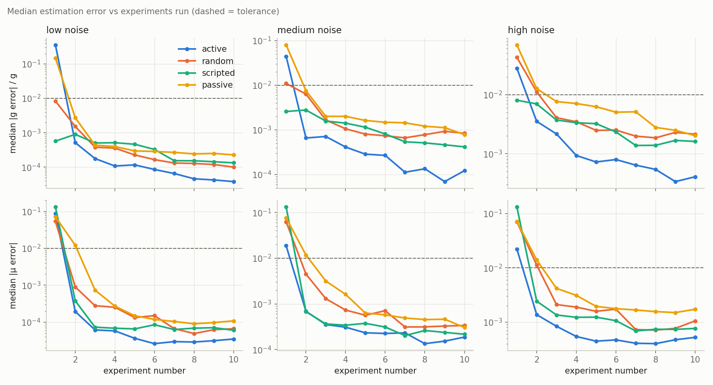

# Results

Budget 10 experiments, 20 seeds per (strategy, noise). True g ~ U(3, 18), μ ~ U(0.1, 0.7), same truths and noise seeds across strategies (paired design). Threshold: |g−g*|/g* ≤ 1 % and |μ−μ*| ≤ 0.01, and it must hold through the end of the budget. Runs that never reach it count as 11 in means.

## low noise

| strategy | mean exps (95% CI) | median | reached | mean cost to threshold | final g rel err (median) | final μ err (median) | traj RMSE m (median) | 90% CI coverage g / μ | plan latency s |
|---|---|---|---|---|---|---|---|---|---|
| active | 2.15 (2.00–2.40) | 2 | 20/20 | 4.7 | 0.0000 | 0.0000 | 0.0000 | 0.92 / 0.98 | 1.23 |
| random | 2.85 (1.85–4.05) | 2 | 19/20 | 6.6 | 0.0001 | 0.0001 | 0.0001 | 0.86 / 0.88 | 0.00 |
| scripted | 1.95 (1.85–2.00) | 2 | 20/20 | 4.2 | 0.0001 | 0.0001 | 0.0001 | 0.58 / 0.75 | 0.00 |
| passive | 3.25 (2.55–4.25) | 3 | 19/20 | 3.2 | 0.0002 | 0.0001 | 0.0002 | 0.92 / 0.92 | 0.00 |

Paired difference in experiments needed (baseline − active; positive = active needs fewer):

| baseline | mean diff (95% paired bootstrap CI) | active fewer / tie / more |
|---|---|---|
| random | +0.70 (-0.30 to +1.95) | 7 / 6 / 7 |
| scripted | -0.20 (-0.45 to +0.00) | 0 / 17 / 3 |
| passive | +1.10 (+0.35 to +2.15) | 9 / 10 / 1 |

## medium noise

| strategy | mean exps (95% CI) | median | reached | mean cost to threshold | final g rel err (median) | final μ err (median) | traj RMSE m (median) | 90% CI coverage g / μ | plan latency s |
|---|---|---|---|---|---|---|---|---|---|
| active | 1.70 (1.50–1.90) | 2 | 20/20 | 4.0 | 0.0001 | 0.0002 | 0.0002 | 0.93 / 0.95 | 1.19 |
| random | 3.45 (2.40–4.75) | 3 | 18/20 | 6.9 | 0.0008 | 0.0003 | 0.0008 | 0.84 / 0.88 | 0.00 |
| scripted | 2.00 (1.85–2.15) | 2 | 20/20 | 4.3 | 0.0004 | 0.0002 | 0.0005 | 0.81 / 0.89 | 0.00 |
| passive | 3.70 (2.90–4.75) | 3 | 19/20 | 3.8 | 0.0008 | 0.0003 | 0.0007 | 0.96 / 0.93 | 0.00 |

Paired difference in experiments needed (baseline − active; positive = active needs fewer):

| baseline | mean diff (95% paired bootstrap CI) | active fewer / tie / more |
|---|---|---|
| random | +1.75 (+0.70 to +3.00) | 15 / 3 / 2 |
| scripted | +0.30 (+0.05 to +0.55) | 7 / 12 / 1 |
| passive | +2.00 (+1.20 to +2.95) | 16 / 4 / 0 |

## high noise

| strategy | mean exps (95% CI) | median | reached | mean cost to threshold | final g rel err (median) | final μ err (median) | traj RMSE m (median) | 90% CI coverage g / μ | plan latency s |
|---|---|---|---|---|---|---|---|---|---|
| active | 1.95 (1.75–2.15) | 2 | 20/20 | 4.8 | 0.0004 | 0.0005 | 0.0007 | 0.93 / 0.96 | 1.17 |
| random | 4.20 (3.15–5.45) | 3 | 18/20 | 9.0 | 0.0021 | 0.0011 | 0.0019 | 0.93 / 0.93 | 0.00 |
| scripted | 2.90 (2.30–3.60) | 2 | 20/20 | 6.7 | 0.0016 | 0.0008 | 0.0018 | 0.80 / 0.90 | 0.00 |
| passive | 5.25 (4.20–6.45) | 5 | 18/20 | 5.3 | 0.0020 | 0.0017 | 0.0024 | 0.92 / 0.93 | 0.00 |

Paired difference in experiments needed (baseline − active; positive = active needs fewer):

| baseline | mean diff (95% paired bootstrap CI) | active fewer / tie / more |
|---|---|---|
| random | +2.25 (+1.25 to +3.45) | 16 / 3 / 1 |
| scripted | +0.95 (+0.30 to +1.70) | 9 / 9 / 2 |
| passive | +3.30 (+2.30 to +4.40) | 19 / 1 / 0 |

## Which experiments each strategy ran (all noise levels)

| strategy | drop | flat_slide | ramp_slide | impulse |
|---|---|---|---|---|
| active | 46% | 17% | 26% | 11% |
| random | 20% | 24% | 24% | 30% |
| scripted | 30% | 30% | 20% | 20% |
| passive | 42% | 57% | 0% | 0% |

## Change detection

Physics re-drawn between experiment 6 and 7 (14-experiment budget); control runs have no change. Detector: max normalized residual at the MAP over all logged experiments > 1.6 for 2 consecutive experiments, then the belief resets to the prior keeping the suspect experiments.

| noise | strategy | detected | mean delay (exps) | false-alarm runs (change runs pre-change + control runs) | recovered to tolerance | mean recovery (exps after change) |
|---|---|---|---|---|---|---|
| low | active | 8/8 | 2.00 | 2/16 | 8/8 | 2.50 |
| low | random | 8/8 | 2.00 | 4/16 | 8/8 | 3.50 |
| medium | active | 8/8 | 2.00 | 0/16 | 8/8 | 2.50 |
| medium | random | 8/8 | 2.12 | 0/16 | 8/8 | 4.12 |
| high | active | 8/8 | 2.00 | 0/16 | 8/8 | 3.38 |
| high | random | 8/8 | 2.12 | 0/16 | 5/8 | 3.80 |
